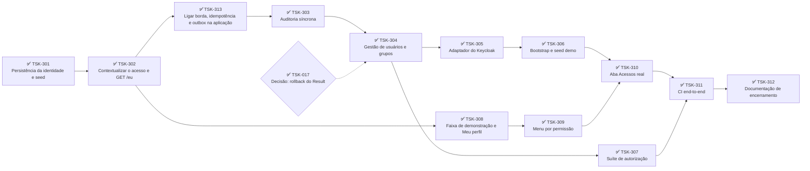

# Project flow: mapa de tasks do CDD

Estado do projeto em **14/10/2026**. Cada task tem um arquivo em [`tasks/`](tasks/) com o contexto, o que fazer, os critérios de aceite e as referências.

## Onde estamos

- **`main`** (ponta `366fb69b`, #216), sem PR aberto fora desta rodada.
- **Backend do B0 completo** (PRs de API entre #37 e #96, de 08 a 10/10):
  - identidade com `GET /eu`, auditoria, gestão de usuários e grupos;
  - adaptador do Keycloak (convite por e-mail, ativação, suspensão);
  - bootstrap e seed demo;
  - suíte de autorização na API;
  - job e2e na CI com Keycloak e Mailpit reais;
  - documentação de encerramento nos Docs 3, 6 e 7, mais três runbooks.
- **Código do B0 completo** (13/10): a issue #77 fechou com o `/entrar` e a ativação do convite (#200), o reenvio com a espera do 429 em Acessos (#202) e o T28a e o T28b do web (#199 e #207). O dono fez o aceite real do convite contra o Keycloak local em 14/10 (convite, senha, `/entrar`, ativação e `GET /eu`): **B0 concluído**.
- **Front:** a refatoração estrutural do `apps/web` em atomic design terminou na `main` (PRs de web entre #56 e #172, de 09 a 11/10) e está registrada no Doc 8 §13. O que sobrou está na TSK-417 (backlog) e na TSK-018 (perguntas ao dono).
- **Redesign Força da Mata concluído** (12/10): a épica `refactor/epica-redesign` (25 PRs, #173 a #195 e #197) foi validada visualmente pelo dono e mesclada na `main` pelo #196. Registro na TSK-601; o que o pre-review deixou está na TSK-602 (técnico) e o que o guia propõe para depois está na TSK-603 (roadmap). A branch da épica pode ser apagada (TSK-004).
- **Backlog mesclado em 13 e 14/10:** #201 (fecha a #47), #203 (tema do Keycloak, TSK-416), #204 (expurgo do outbox, fecha a #43), #205 e #206 (TSK-602, itens 1 a 4), #208 e #211 (TSK-413), #209 (TSK-408), #210 (TSK-417, estado em `hooks/`), #213 (TSK-411 e TSK-415), #214 (TSK-414), #215 (TSK-409) e #216 (TSK-018, financeiro).
- **Próximos passos:**
  - o resto do backlog técnico (grupos 4 e 7);
  - a TSK-018 no front: eventos e inscrição (itens 4 a 8) e litros (item 9);
  - as decisões antes da B1 (TSK-014 e Doc 6 §9);
  - dividir a TSK-501 em tasks.

## Resumo

| Grupo | Tasks | Abertas |
|---|:-:|:-:|
| 1. Processo e higiene | 8 | 3 |
| 2. Decisões (usuário ou coordenação) | 8 | 3 |
| 3. B0: caminho crítico | 13 | 0 |
| 4. Backlog técnico das revisões | 17 | 5 |
| 5. B0 concluído (fundação, mesclado até 07/10) | 24 | 0 |
| 6. Roadmap: B1 a B6 e migração | 7 | 7 |
| 7. Redesign Força da Mata | 3 | 2 |

## Caminho crítico do B0

## 1. Processo e higiene

| Task | Título | Estado | Peça | PR | Depende de |
|---|---|---|---|---|---|
| [TSK-001](tasks/TSK-001-mesclar-pilha-da-fundacao.md) | Mesclar a pilha da fundação (#19 e filhos) | ✅ Feito (06/10/2026) | — | — | — |
| [TSK-002](tasks/TSK-002-mesclar-identidade-guarda-front-tema.md) | Mesclar identidade, guarda, front e tema (#25–#30) | ✅ Feito (06/10/2026) | — | — | — |
| [TSK-003](tasks/TSK-003-limpar-residuo-docker-e-recriar-ambiente.md) | Limpar resíduo do Docker e recriar o ambiente local | ✅ Feito (07/10/2026) | — | — | — |
| [TSK-004](tasks/TSK-004-limpar-worktrees-e-branches.md) | Limpar worktrees e branches temporárias depois dos merges | ✅ Feito (07/10/2026) | — | — | TSK-001, TSK-002 |
| [TSK-005](tasks/TSK-005-restaurar-codefox-e-convencoes.md) | Restaurar o `.codefox.yaml` do projeto com as convenções | ✅ Feito (versionado no #37, 08/10/2026) | — | — | — |
| [TSK-006](tasks/TSK-006-versionar-documentos-de-desenho.md) | Versionar os Documentos 1–5 v2.2 em `docs/` | 🔧 Processo (ação manual) | — | — | — |
| [TSK-007](tasks/TSK-007-residuos-de-ids-e-pisos.md) | Resíduos conhecidos: ID de plano no compose e piso do verificador | 🔧 Processo (ação manual) | — | — | TSK-001 |
| [TSK-008](tasks/TSK-008-compose-por-worktree.md) | Isolar o Docker por worktree | 🔧 Processo (ação manual), parcial: o aceite já roda isolado | — | — | — |

## 2. Decisões (usuário ou coordenação)

| Task | Título | Estado | Peça | PR | Depende de |
|---|---|---|---|---|---|
| [TSK-011](tasks/TSK-011-decidir-textos-de-recusa-e-contato.md) | Textos das telas de recusa e contato do administrador | 🧭 Decisão pendente (coordenação) | — | — | — |
| [TSK-012](tasks/TSK-012-decidir-topologia-e-provedor-de-deploy.md) | Topologia e provedor de deploy (SPA e Keycloak no mesmo site) | 🧭 Decisão pendente | — | — | — |
| [TSK-013](tasks/TSK-013-decidir-expurgo-de-idempotencia.md) | Expurgo das chaves de idempotência e retenção do corpo da resposta | ✅ Decidido e feito (#36, 07/10/2026) | — | — | TSK-001 |
| [TSK-014](tasks/TSK-014-decisoes-do-plano-com-a-coordenacao.md) | Confirmar com a coordenação as decisões 1–8 do plano | 🧭 Decisão pendente | — | — | — |
| [TSK-015](tasks/TSK-015-decidir-email-no-evento-de-convite.md) | E-mail em `USUARIO_CONVIDADO` × trilha de auditoria (LGPD) | ✅ Decidido (implementa no TSK-303) | — | — | — |
| [TSK-016](tasks/TSK-016-decidir-marca-apenas-usuario-ativo.md) | Registrar a exceção ao T24 (`@ApenasUsuarioAtivo` para `GET /eu`) | ✅ Feito (Doc 3 §14.5 no #96; teste no #53) | — | — | TSK-002 |
| [TSK-017](tasks/TSK-017-decidir-rollback-do-result-de-erro.md) | Rollback quando o comando devolve `Result` de erro | ✅ Feito (#37, 08/10/2026) | — | — | — |
| [TSK-018](tasks/TSK-018-decidir-perguntas-do-front.md) | Nove perguntas do front deixadas pelas correções de comportamento | ✅ Decidido (13/10); financeiro no #216, eventos e litros no front | — | #216 | — |

## 3. B0: caminho crítico

| Task | Título | Estado | Peça | PR | Depende de |
|---|---|---|---|---|---|
| [TSK-301](tasks/TSK-301-persistencia-da-identidade-e-seed.md) | Persistência da identidade e seed dos grupos por instituição | ✅ Feito (#38, 08/10/2026) | I04 | #38 | TSK-001, TSK-002 |
| [TSK-302](tasks/TSK-302-contextualizar-e-get-eu.md) | Contextualizar o acesso e `GET /api/v1/eu` | ✅ Feito (#39, 08/10/2026) | I06 | #39 | TSK-301 |
| [TSK-303](tasks/TSK-303-auditoria-sincrona.md) | Auditoria síncrona e `GET /identidade/auditoria` | ✅ Feito (mesclado em 08/10/2026, `38782e7`) | I07 | #41 | TSK-302, TSK-313 |
| [TSK-304](tasks/TSK-304-gestao-de-usuarios-e-grupos.md) | Gestão de usuários e grupos (comandos e HTTP) | ✅ Feito (08 e 09/10/2026) | I08 | #45, #48, #49 | TSK-303 |
| [TSK-305](tasks/TSK-305-adaptador-keycloak.md) | Adaptador do Keycloak: convite por e-mail, ativação e suspensão | ✅ Concluída (aceite real do dono em 14/10/2026) | I10 | #51, #52, #65, #74, #76, #79, #80, #200, #202 | TSK-304, TSK-002 |
| [TSK-306](tasks/TSK-306-cli-bootstrap-e-seed-demo.md) | CLI de bootstrap do primeiro administrador e seed demo | ✅ Concluída (PR 5 opcional não iniciado) | I11 | #81, #89, #90, #91 | TSK-305 |
| [TSK-307](tasks/TSK-307-suite-de-autorizacao-e-estruturais.md) | Suíte de autorização (Doc 3 §11) e testes estruturais T28/T30 | ✅ Concluída (13/10/2026) | I12 | #53, #66, #75, #78, #199, #207 | TSK-304 |
| [TSK-308](tasks/TSK-308-faixa-de-demonstracao-e-meu-perfil.md) | Faixa "dados de demonstração" e Meu perfil real | ✅ Concluída | W03 | #42 | TSK-302 |
| [TSK-309](tasks/TSK-309-shell-com-menu-por-permissao.md) | Menu filtrado por permissão e `PermissionDenied` | ✅ Concluída | W04 | #46 | TSK-308 |
| [TSK-310](tasks/TSK-310-aba-de-acessos.md) | Aba Acessos real (A-01/A-02) | ✅ Concluída | W05 | #50, #55 | TSK-304, TSK-309 |
| [TSK-311](tasks/TSK-311-ci-e2e.md) | CI end-to-end do aceite do B0 | ✅ Concluída | E01 | #94 | TSK-306, TSK-310 |
| [TSK-312](tasks/TSK-312-documentacao-de-encerramento-do-b0.md) | Documentação de encerramento do B0 | ✅ Concluída | D01 | #96 | TSK-311 |
| [TSK-313](tasks/TSK-313-ligar-borda-idempotencia-e-outbox-na-aplicacao.md) | Ligar borda, idempotência, outbox e adaptador de instituição na aplicação | ✅ Feito (#40, 08/10/2026) | — | #40 | TSK-302 |

## 4. Backlog técnico das revisões

| Task | Título | Estado | Peça | PR | Depende de |
|---|---|---|---|---|---|
| [TSK-401](tasks/TSK-401-outbox-evento-esgotado.md) | Outbox: evento esgotado trava o agregado | ✅ Feito (#35, 07/10/2026) | — | — | TSK-001 |
| [TSK-402](tasks/TSK-402-contexto-da-transacao-sem-fork.md) | Estreitar `ContextoDaTransacao` (sem `fork`/`transactional`) | ✅ Feito (teste estrutural do T28a, #66) | — | — | TSK-001 |
| [TSK-403](tasks/TSK-403-outbox-flush-timeout-e-pool.md) | Outbox: flush fora do timer, timeout fora da config e conexão read-only | 📌 Backlog técnico (aceito para o B0) | — | — | TSK-001 |
| [TSK-404](tasks/TSK-404-grupo-renomear-com-evento.md) | Grupo: `renomear` com autor e evento | ✅ Feito (#25, `fb7261d`) | — | — | TSK-002 |
| [TSK-405](tasks/TSK-405-idempotencia-deteccao-de-res.md) | Idempotência: detecção de `@Res` robusta | ✅ Feito (#23, `ad4169c`) | — | — | TSK-001 |
| [TSK-406](tasks/TSK-406-guarda-backlog.md) | Guarda de acesso: pendências menores | 📌 Backlog técnico | — | — | TSK-002 |
| [TSK-407](tasks/TSK-407-front-dados-ajustes.md) | Front: ajustes da camada de dados e do lint | ✅ Feito (#51 e #76, #127 e #129, #136) | — | — | TSK-002 |
| [TSK-408](tasks/TSK-408-login-ajustes.md) | Login: refetch do `/eu`, recusa no meio da sessão e prazo do `.well-known` | ✅ Feito (#209); a revisão da classificação de erros fica para depois do uso real | — | #209 | TSK-002 |
| [TSK-409](tasks/TSK-409-uow-reuso-aninhado-e-teste-vazio.md) | UoW: reuso da transação aninhada e teste que não prova o `lastValueFrom` | ✅ Feito (#215) | — | #215 | — |
| [TSK-410](tasks/TSK-410-kysely-fronteira-e-teste-de-tipo.md) | Kysely: tabelas de todos os módulos visíveis a qualquer módulo | 📌 Backlog técnico | — | — | — |
| [TSK-411](tasks/TSK-411-erros-sem-frase-do-zod.md) | Erros: `CORPO_INVALIDO` sem frases do Zod | ✅ Feito (#213) | — | #213 | — |
| [TSK-412](tasks/TSK-412-idempotencia-ressalvas.md) | Idempotência: ressalvas da revisão e do expurgo | 📌 Backlog técnico (o POST sem modo de transação foi resolvido no #40) | — | — | TSK-313 |
| [TSK-413](tasks/TSK-413-outbox-ressalvas.md) | Outbox: evento sem consumidor, log do ciclo e vigia | ✅ Feito (#208, #211); o filtro de métrica ou Sentry depende da TSK-012 | — | #208, #211 | TSK-313 |
| [TSK-414](tasks/TSK-414-dominio-identidade-ressalvas.md) | Domínio de identidade: G3 e nits de grupos | ✅ Feito (#214); G3 como risco aceito e o ADMINISTRADOR como follow-up | — | #214 | — |
| [TSK-415](tasks/TSK-415-fakes-de-teste-fora-do-dist.md) | Fakes de teste em `src/` entram no build | ✅ Feito (#213) | — | #213 | — |
| [TSK-416](tasks/TSK-416-tema-keycloak-ressalvas.md) | Tema do Keycloak: texto de senha, e-mail de ações e título | ✅ Feito (#203), com o item 7 da TSK-602 e o assunto "Sistema de Gestão CDD" | — | #203 | — |
| [TSK-417](tasks/TSK-417-backlog-do-front-pos-refatoracao.md) | Backlog do front depois da refatoração (desvios, apoios de teste, divergências; Tailwind saiu no #173/#196) | 🚧 Parcial: estado em `hooks/` no #210; o resto segue no backlog | — | #210 | — |

## 5. B0 concluído (mesclado na `main`)

| Task | Título | Estado | Peça | PR | Depende de |
|---|---|---|---|---|---|
| [TSK-101](tasks/TSK-101-build-do-contracts.md) | Build do `@cdd/contracts` com exports condicionais | ✅ Feito (na `main`) | F01 | #1 | — |
| [TSK-102](tasks/TSK-102-infra-local.md) | Ambiente local: Postgres 16, SeaweedFS e Mailpit | ✅ Feito (na `main`) | F02 | #2 | — |
| [TSK-103](tasks/TSK-103-keycloak-e-realm.md) | Keycloak 26 com realm versionado e verificadores | ✅ Feito (na `main`) | F03 | #3 | — |
| [TSK-104](tasks/TSK-104-contracts-de-identidade.md) | Contracts de identidade (64 permissões, 6 grupos) | ✅ Feito (na `main`) | I01 | #4 | — |
| [TSK-105](tasks/TSK-105-esqueleto-da-api.md) | Esqueleto da API NestJS 12 ESM | ✅ Feito (na `main`) | F04 | #5 | — |
| [TSK-106](tasks/TSK-106-kernel-e-erros.md) | Kernel de domínio e catálogo de erros | ✅ Feito (na `main`) | F05 | #6 | — |
| [TSK-107](tasks/TSK-107-esquema-de-referencia.md) | Esquema de referência e ajustes de identidade | ✅ Feito (na `main`) | F07 + F08 | #7, #8 | — |
| [TSK-108](tasks/TSK-108-corte-banco-dominio.md) | Corte banco × domínio (issue #11): documentação e contrato | ✅ Feito (na `main`) | R1 + R2 | #12, #13 | — |
| [TSK-109](tasks/TSK-109-migrador.md) | Migrador MikroORM 7 com CLI restrito ao dono do banco | ✅ Feito (na `main`) | F09a | #14 | — |
| [TSK-110](tasks/TSK-110-migration-do-b0.md) | Migration do B0 (shared, identidade, catálogo) | ✅ Feito (na `main`) | F09b | #15 | — |
| [TSK-111](tasks/TSK-111-ci-de-qualidade.md) | CI de qualidade (typecheck, oxlint, fronteiras, testes) | ✅ Feito (na `main`) | F06 | #16 | — |
| [TSK-112](tasks/TSK-112-harness-e-garantias.md) | Harness de integração e garantias do banco migrado | ✅ Feito (na `main`) | F10 (+F11) | #17 | — |
| [TSK-201](tasks/TSK-201-unidade-de-trabalho-e-borda.md) | Unidade de trabalho e borda transacional (#19) | ✅ Feito (mesclado em 06/10/2026, `cec80ca`) | F12 | #19 | — |
| [TSK-202](tasks/TSK-202-tipos-kysely.md) | Tipos do Kysely gerados do banco migrado (#20) | ✅ Feito (mesclado em 06/10/2026, `cec80ca`) | F13 | #20 | TSK-201 |
| [TSK-203](tasks/TSK-203-filtro-de-erros.md) | Filtro global de erros, If-Match e validação Zod (#22) | ✅ Feito (mesclado em 06/10/2026, `a9b4d1d`) | F14 | #22 | TSK-201 |
| [TSK-204](tasks/TSK-204-logs-e-prontidao.md) | Logs com correlação e redação e `/saude/pronta` (#21) | ✅ Feito (mesclado em 06/10/2026, `675dbbe`) | F17 | #21 | TSK-201 |
| [TSK-205](tasks/TSK-205-idempotencia.md) | Idempotency-Key sob a borda transacional (#23) | ✅ Feito (mesclado em 06/10/2026, `dbbb706`) | F16 | #23 | TSK-201 |
| [TSK-206](tasks/TSK-206-outbox-e-despachante.md) | Outbox transacional, despachante e `@ReageA` (#24) | ✅ Feito (mesclado em 06/10/2026, `10b66d7`) | F15 | #24 | TSK-201 |
| [TSK-207](tasks/TSK-207-dominio-de-grupos.md) | Domínio de grupos e permissões efetivas (#25) | ✅ Feito (mesclado em 06/10/2026, `0e909bb`) | I02 | #25 | — |
| [TSK-208](tasks/TSK-208-dominio-de-usuario.md) | Domínio do usuário, convite e último administrador (#26) | ✅ Feito (mesclado em 06/10/2026, `0238da4`) | I03 | #26 | TSK-207 |
| [TSK-209](tasks/TSK-209-guarda-de-acesso.md) | Guarda global de acesso com JWT e marcas de rota (#27) | ✅ Feito (mesclado em 06/10/2026, `ea84659`) | I05 | #27 | — |
| [TSK-210](tasks/TSK-210-camada-de-dados-do-front.md) | Camada de dados do front (#28) | ✅ Feito (mesclado em 06/10/2026, `c19d1f0`) | W01 | #28 | — |
| [TSK-211](tasks/TSK-211-tema-do-keycloak.md) | Tema CDD do Keycloak (login e e-mail em pt-BR) (#29) | ✅ Feito (mesclado em 06/10/2026, `32ce9f8`) | I09 | #29 | — |
| [TSK-212](tasks/TSK-212-login-oidc.md) | Login real por OIDC e sessão vinda do `GET /eu` (#30) | ✅ Feito (mesclado em 06/10/2026, `b2dfcaa`) | W02 | #30 | TSK-210 |

PRs de acompanhamento já mesclados: [#34](https://github.com/AurioNeto/ceudodespertar/pull/34) (resgate do #21), [#35](https://github.com/AurioNeto/ceudodespertar/pull/35) (pendências do #21) e [#36](https://github.com/AurioNeto/ceudodespertar/pull/36) (issue #31).

## 6. Roadmap: B1 a B6 e migração

| Task | Título | Estado | Peça | PR | Depende de |
|---|---|---|---|---|---|
| [TSK-501](tasks/TSK-501-etapa-b1-financeiro-nucleo.md) | Etapa B1: financeiro núcleo | 🗺️ Roadmap | — | — | TSK-311 |
| [TSK-502](tasks/TSK-502-etapa-b2-financeiro-resto.md) | Etapa B2: financeiro, o resto | 🗺️ Roadmap | — | — | TSK-311 |
| [TSK-503](tasks/TSK-503-etapa-b3-importacao-conciliacao.md) | Etapa B3: importação e conciliação | 🗺️ Roadmap | — | — | TSK-311 |
| [TSK-504](tasks/TSK-504-etapa-b4-pessoas-anamnese.md) | Etapa B4: pessoas e anamnese | 🗺️ Roadmap | — | — | TSK-311 |
| [TSK-505](tasks/TSK-505-etapa-b5-eventos.md) | Etapa B5: eventos | 🗺️ Roadmap | — | — | TSK-311 |
| [TSK-506](tasks/TSK-506-etapa-b6-estoque.md) | Etapa B6: estoque | 🗺️ Roadmap | — | — | TSK-311 |
| [TSK-507](tasks/TSK-507-migracao-dos-dados.md) | Migração dos dados históricos | 🗺️ Roadmap | — | — | TSK-311 |

## 7. Redesign Força da Mata

| Task | Título | Estado | Peça | PR | Depende de |
|---|---|---|---|---|---|
| [TSK-601](tasks/TSK-601-epica-redesign-forca-da-mata.md) | Épica do redesign Força da Mata (Noite e Amanhecer) | ✅ Concluída (#196, `434544fb`, 12/10/2026) | — | #173–#195, #197, #196 | TSK-417 (Tailwind) |
| [TSK-602](tasks/TSK-602-backlog-tecnico-do-redesign.md) | Backlog técnico do redesign (minors do pre-review, verificações em aparelho, e-mail do Keycloak) | 🚧 Itens 1 a 4 e 7 feitos (#205, #206, #203); itens 5, 6 e 8 são verificação do dono | — | #203, #205, #206 | TSK-601 |
| [TSK-603](tasks/TSK-603-fases-futuras-da-mata.md) | Fases futuras da mata (preferências na API, guardiões, foto, cerimônia no registro, animações, troca automática) | 🗺️ Roadmap | — | — | TSK-601, backend de preferências, centro |

## Riscos aceitos

- **`detail` dos erros do Postgres** (07/10): erros de restrição trazem valores no `detail` (`Key (…)=(…) already exists`, `Failing row contains (…)`), e o `DriverException` do MikroORM copia esse campo. O valor só vaza se alguém logar o objeto do erro. Nesses formatos o CPF vem delimitado e a máscara pega. Ver #35.
- **CPF colado em letra** (07/10): `CPF nº12345678901` não é mascarado no log, porque nenhum fluxo atual ou previsto produz esse formato.

## Convenções

- **Um PR por peça.** Crivo antes do PR quando a peça toca autenticação, schema, dinheiro ou mais de 3 arquivos.
- **Sessões paralelas** (desde 12/10): a orquestração delega as tasks às sessões de front e de back, que trabalham em worktree própria e abrem o PR sem review. O revisor roda o codefox, o corretor trata os apontamentos e o dono mescla com `--match-head-commit` no head aprovado. O executor atualiza só o arquivo da própria task; este README é da orquestração.
- **Merge** sempre com "Create a merge commit". O repositório **não apaga a branch nem troca a base dos filhos**: antes de mesclar um filho de pilha, rode `gh pr edit N --base main`. Depois de trazer a `main` para uma branch, rode a suíte inteira, porque há conflito de comportamento que não aparece como conflito de texto.
- **Limpeza:** apague worktrees e branches (locais e remotas) depois de cada merge (TSK-004).
- **Docker:** nunca `down -v` no projeto `cdd`, que é compartilhado. Em worktree, use `-p <nome-único>`.
- **IDs do plano:** os códigos (F12, I04…) aparecem aqui porque este é o mapa do plano. Docs, código, nomes de teste e corpos de PR do repositório não os citam.
- **Épica de redesign:** branch de épica com PRs que saem e voltam para ela e um merge único na `main`; execução por sessão separada em worktree própria, revisão e gate pela sessão principal, validação visual do dono só no fim (TSK-601).
- **Fontes:** plano local do dono, fora do repositório (`~/.claude/plans/agora-fa-a-um-planejamento-swirling-stonebraker.md`); Documentos 6, 7 e 8 em `docs/`; Documentos 1–5 em `project/uploads/CDD - System/` (ver TSK-006); runbooks em `docs/runbooks/`.
