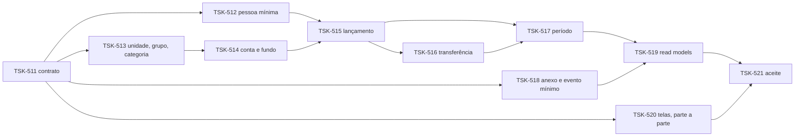

# TSK-501: Etapa B1: financeiro núcleo

- **Estado:** 📋 Dividida em tasks (14/10/2026): TSK-511 a TSK-521
- **Responsável sugerido:** por módulo (molde P1–P11)
- **Depende de:** [TSK-311](TSK-311-ci-e2e.md)

## Contexto

Etapa do roteiro do plano, estimada em **7–8 semanas**. Cada módulo segue o molde P1 (contrato) → P2 (domínio) → P3 (migration) → P4 (persistência) → P5 (comandos) → P6 (HTTP) → P7 (read models) → P8 (casos T e concorrência) → P9 e P10 (front) → P11 (docs).

## O que precisa ser feito

- **Entrega:** Unidade, GrupoDeCusto, Categoria, Conta, Fundo, Lancamento (etiquetas, pendência, estorno derivado), Transferencia, PeriodoContabil (hash; lock no repositório), Pessoa mínima, Evento mínimo; read models de DRE, saldo e resultado; porta S3 (comprovante); telas F-01 a F-23 e Painel.
- **Decisões do dono (14/10/2026), todas conforme a recomendação da orquestração:**
  1. Chácara e Dormitórios semeados sem receita comercial, de forma provisória até a coordenação (Doc 6 §9.1 #3).
  2. Unidade ativa só pré-preenche formulários; nas listas, filtro visível e removível; a confirmação do lançamento mostra a unidade (provisória até a tesouraria, Doc 6 §9.1 #4).
  3. A transferência entra no hash do período.
  4. Confirmar transferência usa a mesma permissão de conferir lançamento, e quem registrou não confirma a própria. A segregação vale só na transferência: no lançamento, quem registrou pode confirmar o próprio (dono, 14/10/2026, na revisão do PR #227).
  5. Lançamento confirmado por integração ou migração tem o sistema (autor `SISTEMA`) como `confirmadoPor`, com a origem registrada.
  6. Ratificadas as decisões 2, 3 e 7 do Doc 7 §27.1.
- **Casos T:** T9 e T13–T16e, 10 casos no catálogo executável do #75. O plano listava também T2, T3 e T6, que o catálogo pôs na B5.
- **Divisão (14/10/2026):**

  O back segue a cadeia; o front entra na TSK-520 à medida que cada endpoint chega à `main`. A TSK-518 corre em paralelo e precisa entrar antes da TSK-519 (o resultado por cerimônia lê o evento).

## Critérios de aceite

- Percurso 1 sem conciliação contra a API; carga M1 sem divergência além do que depende do B2.

## Referências

- Plano: "Roteiro B1–B6 e migração"
- Doc 7: anexo "Inventário do corte"

_Atualizado em 14/10/2026._
